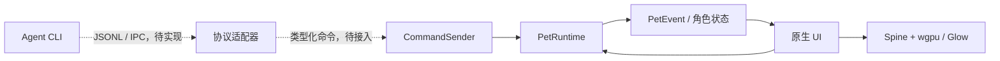

# 架构与扩展

当前应用采用一个进程、一份角色状态和一个 GPU 渲染器。Rust 1.95、eframe/egui 0.36.2 提供核心和界面基础，GPU 后端为 wgpu 30 或 Glow。启动器负责资源与设置，桌宠窗口负责桌面交互；两者复用模型和纹理，不启动第二套动画运行时。核心库不依赖 UI，外部集成通过类型化命令进入核心。

## 模块与依赖

| 模块 | 当前职责 | 边界 |
| --- | --- | --- |
| `src/model.rs`、`src/config.rs` | 本地模型清单、资源位置、角色参数 | 不创建窗口或 GPU 资源 |
| `src/animation.rs`、`src/physics.rs`、`src/character.rs` | 动作选择、物理与角色状态 | 由调用方提供时间步长和边界 |
| `src/runtime.rs` | `PetRuntime`、类型化命令、暂停与自动动作、命令处理结果 | 不知道 egui、Spine、网络或进程通信 |
| `src/spine.rs`、`src/spine_bridge.c` | 官方 Spine 3.8 的所有权、动画推进与裁剪网格输出 | 只处理可信本地 Spine 3.8 资源 |
| `src/ui/renderer.rs` | 图集纹理、网格转换、连续 slot 批处理 | 不决定行为或处理外部协议 |
| `src/ui/backend.rs` | 后端选择、平台可用性校验、独立 bootstrap 配置 | 在创建窗口和 GPU 资源之前确定后端 |
| `src/ui/desktop.rs` | 桌宠窗口位置、工作区与手动底部边界、拖拽与桌面物理 | Windows 自动读取显示器工作区；手动高度以物理像素转换到 UI 坐标 |
| `src/ui/platform.rs` | Windows 桌宠任务栏与 Alt+Tab 样式、边框颜色和圆角属性 | 仅访问当前 GUI 线程的桌宠窗口，不合成图像 |
| `src/ui/shell_visibility.rs` 及其子模块 | 跨平台系统条目可见性；Linux EWMH、macOS AppKit | 保持桌宠映射和动画运行，不重建渲染器；macOS 策略作用于整个应用 |
| `src/ui/mod.rs` | 原生窗口、设置、输入、持久化与帧调度 | 将核心状态转换成 UI 和渲染调用 |
| `src/ui/performance.rs`、`docs/scripts/` | 可重复的性能采样和实际窗口透明验证 | 诊断显式启用，不参与日常逐帧截图 |

## 状态与重绘

`NativeApp` 使用 `Arc<Mutex<App>>` 让根窗口和 deferred 桌宠回调访问同一份应用状态。锁保护的是共享所有权；当前窗口回调仍由 eframe 的事件循环驱动，没有为每个窗口创建计算线程。

每次选择模型只保留一份 `PetRuntime` 和 `Renderer`。`PetRuntime` 拥有 `CharacterState`，`Renderer` 拥有 Spine 实例、复用的骨骼输出缓冲和图集纹理。切换模型替换角色与渲染资源，保留运行时的命令入口。预览区域的物理位置和桌面窗口位置是不同坐标空间，桌面位置由 `DesktopMotion` 管理。

动画推进有一个明确的驱动者：

- 桌宠关闭且模型库预览可见时，根窗口按设定频率推进和绘制动画。
- 桌宠打开时，deferred 桌宠回调负责推进动画和桌面物理，根窗口不再定时重绘。主预览显示最后一次根窗口绘制时的状态，输入或设置变更会刷新它。
- 暂停后停止定时动画更新，输入和外部命令仍可以唤醒窗口。关闭桌宠后，预览恢复其更新职责。

帧调度维护绝对截止时间，并补偿 egui 对 `predicted_dt` 的减除；只有到达截止时间才推进骨骼和物理。鼠标、焦点或窗口事件仍可请求绘制、处理命令，但不会因此额外推进动画。窗口位置按物理像素对齐并与实际已发送的位置比较，避免重复移动命令又触发更多重绘事件。

Windows 拖动从 `GetCursorPos` 读取屏幕光标，再转换到显示器工作区坐标。窗口自身移动不会被误认为鼠标移动；释放速度受物理参数的最大速度限制。获取光标失败会报告错误并停止该次拖动。其他平台使用窗口输入换算的坐标，仍需分别实机验证。

桌宠每秒刷新一次活动边界，暂停时也保持这项低频检查。自动模式读取 `MONITORINFO.rcWork`；手动模式保留工作区的上、左、右边界，以 `rcMonitor.bottom - height / pixels_per_point` 替换底部边界。设置变更立即触发读取，保留当前屏幕位置并裁剪越界坐标，降低底部边界后由重力继续落下。

系统条目可见性共用 `show_in_taskbar` 偏好。Windows 使用 `WS_EX_TOOLWINDOW` / `WS_EX_APPWINDOW`，运行中按照隐藏、更新样式、无激活显示的顺序通知系统外壳。原生子类通过 `WM_STYLECHANGING` 保留此策略，避免 winit 在显示窗口、置顶和鼠标穿透变更时覆盖。此选项不改变 `ViewportBuilder.taskbar`，因此不会触发 eframe 重建窗口和 GPU surface。

Linux 显式选择 X11，在 Wayland 会话下通过 XWayland 运行。设置变更时按 PID 和窗口标题定位自己的桌宠窗口，未映射时保留其他状态并写入初始 EWMH 提示；已映射时发送 `_NET_WM_STATE` 请求，由窗口管理器更新 `SKIP_TASKBAR` / `SKIP_PAGER`。不设置 `HIDDEN` 状态，也不取消窗口映射。窗口管理器必须声明支持这两个状态，Alt+Tab 的具体筛选行为取决于桌面环境。

macOS 在 AppKit 主线程切换 `NSApplication` 的 Regular/Accessory 激活策略，并保留策略切换前已显示的窗口。桌宠通过 `NSWindowCollectionBehavior` 控制窗口循环和 Mission Control 行为，禁用失去激活时隐藏；启动器与桌宠处于同一进程，因此 Dock/Command+Tab 策略作用于整个应用。收起桌宠会恢复 Regular 策略。两种非 Windows 实现均不改变动画调度。

## 渲染路径

Spine 在 CPU 上计算骨骼、蒙皮和裁剪，Rust 接收网格并交给 egui 的 wgpu 或 Glow 后端进行纹理采样与三角形绘制。图集只在载入资源时上传，保留原始 PNG 尺寸，使用线性采样。窗口按照系统 DPI 渲染，没有固定低分辨率中间画布。

每帧的 C 网格输出复用 Rust 缓冲。提交给 egui 的网格按相邻图集批次分配顶点和索引容量，不再为每个 slot 单独分配一个 mesh。批次内保留 slot 顺序并修正索引偏移，普通与加色混合由顶点预乘颜色表达。不同图集之间不重新排序，也不保留已交给 egui 的 Arc 网格来强行复用。

| 平台 | 后端与透明呈现 |
| --- | --- |
| Windows，默认 | wgpu DX12，显式选择 `DxgiFromVisual`，由 DirectComposition 合成预乘 alpha |
| Windows，可选 | Glow / OpenGL，由原生透明子窗口和系统合成器呈现 |
| macOS | wgpu Metal，使用窗口 surface 提供的透明合成能力 |
| Linux | wgpu Vulkan，透明能力取决于驱动及窗口系统 |

Windows DX12 使用最初在 [wgpu 27 引入的官方 DirectComposition 路径](https://github.com/gfx-rs/wgpu/releases/tag/v27.0.0)，当前依赖为 wgpu 30。OpenGL 使用 [eframe 0.36.2 的官方透明子窗口修复 #8423](https://github.com/emilk/egui/pull/8423)。两个后端都让系统合成器呈现 GPU 结果，正常渲染没有逐帧像素读回和 GDI 拷贝。wgpu 路径为根窗口启用全局透明 backbuffer 能力，再由 UI 绘制不透明背景；桌宠保留透明背景。自动截图检查是显式诊断，会按需读回图像。

DX12 还必须在 HWND 创建时设置 `WS_EX_NOREDIRECTIONBITMAP`，否则 DirectComposition 的透明像素后方仍可能出现窗口自身的不透明背景。egui-winit 0.36.2 未开放此选项，因此通过 `vendor/egui-winit` 的小型补丁把线程内配置传入 winit 的 `with_no_redirection_bitmap`；`run()` 仅在 DX12 下启用，覆盖主窗口和后续桌宠窗口，并由 winit 在样式更新时保留。Windows 拒绝在创建后通过 `SetWindowLongW` 补设此标志（错误码 87）。详见 [补丁说明](../vendor/egui-winit/PATCH.md) 和 [微软窗口合成说明](https://learn.microsoft.com/en-us/archive/msdn-magazine/2014/june/windows-with-c-high-performance-window-layering-using-the-windows-composition-engine)。

DX12 的两个窗口共享 UI 线程，获取 backbuffer 时不等待窗口的 frame-latency handle，避免被遮挡窗口阻塞另一窗口。此配置必须配合 `PresentMode::Mailbox`：此前使用的 `LOW_LATENCY` 预设实际选择 `AutoVsync` / FIFO，在持续双窗口重绘下会积压 GPU 工作，延迟回收上传缓冲和命令分配器，导致数 GB 内存增长及长时间等待。Mailbox 在 DX12 中使用 `Present(0, 0)`，允许替换过时的待呈现帧；动画仍由应用的截止时间限帧。Metal / Vulkan 保留原有呈现配置。

`backend.rs` 先解析 `--renderer`，其次读取 `ARKPETS_RENDERER`、用户数据目录下的 `bootstrap.json`，最后使用平台默认值。只有文件不存在时使用默认值；未知后端、当前平台不支持的后端、非法配置或读写失败均返回错误。设置页选择后端后立即保存配置并请求切换；当前 eframe 调用返回、释放旧窗口和 GPU 资源后，在同一进程内复用事件循环创建新后端。`App`、`PetRuntime` 和 Spine 实例保留，图集纹理重新绑定到新的 egui Context，桌宠首次绘制时重新定位并显示。切换不启动子进程，因此启动终端会一直等待至用户真正退出。bootstrap 目录通过 `eframe::storage_dir("ArkPets")` 取得；采样和截图使用独立目录隔离用户配置。

平台依赖显式选择后端，Windows 同时编译 Glow 和 DX12，macOS 编译 Metal，Linux 编译 Vulkan / GLES，但当前选择接口只开放 Vulkan。DX12 相关的 `wgpu-hal` 与 `gpu-allocator` 在锁文件中共用 `windows 0.62.2`。不同 GPU 驱动的 CPU 内存和呈现开销需要分别测量；不能仅根据后端名称推断实际节省。

Spine C 包装实现 `Send` 而不实现 `Sync`。独占模型可转移到其他线程，实例的更新和释放仍要求独占访问。载入锁保护上游 C 的共享初始化和解析状态；不在每帧动画更新中加全局锁。后续改动若引入全局分配器、静态清理、随机顶点效果或其他共享 C 状态，需要重新审查这个约束。

## 命令入口

`PetRuntime` 已有以下命令：播放动作、设置方向、更新配置、暂停、切换自动动作和交互。UI 暂停按钮创建临时 `CommandSender`，绑定只请求重绘的 waker，再通过 `try_send` 提交 `SetPaused`；配置修改等同步操作调用 `PetRuntime::apply`。异步来源可持有克隆的 `CommandSender`，提交同样的 `PetCommand`。

应用状态不长期保存捕获 egui `Context` 的 sender / waker，避免 Context 保存 deferred 回调、回调持有 App、App 又持有 Context 的 Arc 引用环。切换模型保留原有 `PetRuntime`，所以其命令入口和暂停状态不会随模型更换而失效。

- 队列容量是 64 条，满载时返回 `SubmitError::Full`，不会阻塞绘制线程或无上限积压。
- 每次 `drain_commands` 最多消费 16 条。前端在用完预算时安排下一次回调，避免一次事件洪峰占满整帧。
- 提交和执行都校验参数。入队成功只表示接收了请求；动作是否存在等状态相关结果由执行时的 `PetEvent` 返回。
- `with_waker` 在成功提交后通知前端。回调只请求重绘，不在调用线程推进模型；失败的提交不会触发唤醒。
- `PetEvent` 由消费方立即处理，没有另一条不断积累的事件队列。当前事件表示命令执行结果，还不是对外订阅协议。

核心只依赖标准同步通道，没有为尚未实现的网络服务引入异步运行时或插件框架。

## 后续接入

下面是扩展边界，不代表已经实现的外部服务：

Agent CLI 的进程启动、标准输入输出、JSONL 解析、重连和用户配置放在适配器层。适配器把外部消息转换成核心命令，并处理队列满、运行时关闭和执行失败；核心不导入任何某个 Agent 的 SDK。当前没有序列化的线协议、IPC 监听端点或终端聊天命令，协议确定后再添加真实需要的命令与应答标识。

消息气泡需要新增消息状态、生命周期和 UI 绘制，再由适配器提交消息命令。养成系统应作为独立核心领域模块管理状态和规则，通过命令更新，持久化独立于窗口和 GPU 资源；是否采用 SQLite 或文件存储，按实际数据量和事务需求决定。当前没有实现消息气泡、养成规则或养成存档，也没有发布供其他用户加载的插件接口。

## 性能与验证

性能比较使用相同机器和 release 构建，固定渲染后端、模型、动作、缩放、目标帧率和窗口场景。Windows 运行 `docs/scripts/Measure-Performance.ps1` 后会先预热，再在桌宠显示且设置页打开的场景下采样；测试偏好与正常用户配置隔离。后端可通过 `ARKPETS_RENDERER` 指定，报告数值应同时记录实际选择的后端。

| 输出 | 测量内容 | 不能据此推出 |
| --- | --- | --- |
| `frames.json` | 桌宠回调完成时刻之间的间隔、p50/p95/p99、超过目标周期 1.5 倍的次数、根窗口更新耗时 | GPU 呈现或显示器实际 FPS |
| `memory.json` | 每 100 ms 采样的进程工作集和私有内存，按实际测量时间窗口筛选，附可执行文件哈希 | 显存占用或单个分配来源 |
| `stdout.log`、`stderr.log` | 所选适配器、运行错误和采样结束信息 | 单独证明透明显示或动画正确 |
| `Verify-Desktop.ps1` 截图 | 控制背景下的实际系统透明合成与模型像素 | 长时间负载的稳定帧率 |

回调结束后仍有 egui 网格处理、GPU 提交和系统呈现工作，因此报告中的 Hz 不标记为屏幕 FPS。状态栏 CPU 时间来自 eframe 的应用耗时，与脚本记录的回调间隔是不同指标。工作集可能受到驱动和系统内存管理影响，需要同时查看私有内存并在一致条件下复测。

跨平台 CI 定义了 Windows、macOS、Linux 的编译、测试和静态检查；Linux 另有独立 Xvfb/Openbox 桌面上的系统条目与动画像素回归。当前本机已运行 Windows 和 WSL Linux 验证，macOS 仅完成新增 AppKit 模块的双架构类型检查，未实测窗口效果。Linux 明确依赖 X11/XWayland，不将原生 Wayland 的限制隐藏为成功结果。
