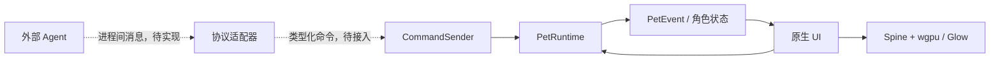

# 架构与扩展

当前应用采用一个进程、一份角色状态和一套共享图集纹理。Rust 1.95、eframe/egui 0.36.2 提供核心和界面基础，GPU 后端为 wgpu 30 或 Glow。启动器负责资源与设置，桌宠窗口负责桌面交互；两者复用模型和纹理，不启动第二套动画运行时。核心库不依赖 UI，已提供进程内类型化命令；未来外部集成由适配器转换为同一组命令。

## 模块与依赖

| 模块 | 当前职责 | 边界 |
| --- | --- | --- |
| `src/model.rs`、`src/config.rs` | 本地模型清单、资源位置、角色参数 | 不创建窗口或 GPU 资源 |
| `src/animation.rs`、`src/physics.rs`、`src/character.rs` | 动作选择、物理与角色状态 | 由调用方提供时间步长和边界 |
| `src/interaction.rs` | 四档交互翻转、水平位移阈值与释放方向 | 不依赖窗口系统；前端传入物理像素指针坐标 |
| `src/runtime.rs` | `PetRuntime`、类型化命令、暂停与自动动作、命令处理结果 | 不知道 egui、Spine、网络或进程通信 |
| `src/spine.rs`、`src/spine_bridge.c` | 官方 Spine 3.8 的所有权、动画推进与裁剪网格输出 | 只处理可信本地 Spine 3.8 资源 |
| `src/ui/renderer.rs` | 图集纹理、网格转换、连续 slot 批处理 | 不决定行为或处理外部协议 |
| `src/ui/renderer/wgpu.rs`、`glow.rs` | GPU 离屏角色合成与整体不透明度 | 共享原始图集，每个视口独立的离屏目标；正常绘制不读回像素 |
| `src/ui/renderer/bounds.rs` | 真实动画与图集 Alpha 的 CPU 边界预计算 | 独立临时 Spine；分析 mask 上限 256，Alpha 姿态上限 4096，战斗几何姿态上限 16384，不改变运行中姿态 |
| `src/ui/effects.rs` | 描边开启条件、手动模式颜色、描边强度过渡与效果参数 | 接收各视口输入；焦点、按下、拖拽与手动模式明确区分 |
| `src/ui/opacity.rs` | 桌宠透明模式的目标不透明度、缓动和连续切换 | 独立于暂停的物理／骨骼时钟；不持有窗口或 GPU 资源 |
| `src/ui/transition.rs` | 位置、朝向、不透明度的属性过渡 | 预览和桌宠分别持有显示状态；单调时钟，不推进骨骼或改写物理目标 |
| `src/ui/backend.rs` | 后端选择、平台可用性校验、独立 bootstrap 配置 | 在创建窗口和 GPU 资源之前确定后端 |
| `src/ui/desktop.rs`、`src/ui/desktop/regions.rs` | 多屏部署、工作区、拖拽与桌面物理；屏幕区域并集的投影和移动约束 | Windows 自动读取工作区；各屏幕按当前窗口 DPI 转换到同一坐标系 |
| `src/ui/platform.rs` | Windows 桌宠任务栏与 Alt+Tab 样式、边框颜色和圆角属性 | 仅访问当前 GUI 线程的桌宠窗口，不合成图像 |
| `src/ui/shell_visibility.rs` 及其子模块 | 跨平台系统条目可见性；Linux EWMH、macOS AppKit | 保持桌宠映射和动画运行，不重建渲染器；macOS 策略作用于整个应用 |
| `src/ui/menu_bar.rs` | macOS 原生菜单栏入口与菜单动作 | `NativeApp` 持有 `NSStatusItem` 和动作接收对象；独立于 Dock 策略 |
| `src/ui/mod.rs` | 原生窗口、设置、输入、持久化与帧调度 | 将核心状态转换成 UI 和渲染调用 |
| `src/ui/performance.rs`、`docs/scripts/` | 可重复的性能采样和实际窗口透明验证 | 诊断显式启用，不参与日常逐帧截图 |

## 状态与重绘

`NativeApp` 使用 `Arc<Mutex<App>>` 让根窗口和 deferred 桌宠回调访问同一份应用状态。锁保护的是共享所有权；当前窗口回调仍由 eframe 的事件循环驱动，没有为每个窗口创建计算线程。

每次选择角色保留一份 `PetRuntime` 和一份活动 `Renderer`。`ui/forms.rs` 根据显式 `characterId`、`skinId`、`form` 配对资源，缓存当前角色最多一个非活动 Renderer；只有活动 Spine 被推进，两个窗口绘制同一份活动网格和图集。切换角色释放旧组资源，关联资源载入失败会明确报告，不能隐式使用别的模型。没有配对元数据的旧清单和单独导入继续作为独立模型；同角色同皮肤的重复形态与不完整元数据被拒绝。

`PetRuntime` 拥有 `CharacterState`，其动作列表始终来自当前活动骨骼。`select_form` 是显式资源切换入口；播放动作只查当前列表，不合并形态动作、不按同名动画查找另一套资源、不借用 Move。切换保留运行时和命令队列，重新选择目标骨骼的初始动作并同步角色资源元数据。不同骨骼之间不使用 Spine mix。`Preferences.form_preferences` 保留原有序列化结构，旧 Auto 仅在载入时解析为保存的 preferred 形态；运行时只保存 active 索引，新选择保存为固定形态。旧模型 ID、收藏和无配对元数据的导入继续兼容。

`App` 持有跨角色复用的 `Compositor`，负责 GPU 图集与离屏资源；活动图集改变时重新绑定，后端变化时重建 GPU 资源，保留运行时的命令入口。缓存复用已解码图集和 Spine，不同时推进两套骨骼。窗口边界设置按活动形态实际应用的配置在缓存激活时同步，不把尚未点击应用的裁剪设置提前生效。预览区域与桌面是不同坐标空间：两者的物理区域都以骨骼 y=0 为底边；`resize_around_feet` / `reframe` 以脚底中心平移物理位置和显示过渡，保留速度与过渡进度，并继续投影到合法工作区。拖拽锚点同时调整，避免尺寸变化产生抛掷速度。

动画推进有一个明确的驱动者：

- 桌宠关闭且模型库预览可见时，根窗口按设定频率推进和绘制动画。
- 桌宠打开时，deferred 桌宠回调负责推进动画和桌面物理。可见的模型库预览按设定帧率持续绘制共享网格，不重复推进 Spine；无需鼠标输入，两处模型均持续播放。
- 暂停后停止定时动画更新，输入和外部命令仍可以唤醒窗口。关闭桌宠后，预览恢复其更新职责。

帧调度维护绝对截止时间，并通过 `request_repaint_at` 统一补偿 egui 对 `predicted_dt` 的减除；动画和每秒工作区检查都使用该入口，避免暂停时在检查截止时间前反复唤醒。只有到达动画截止时间才推进骨骼和物理。只有回调开始时已经到期，才能安排下一次动画截止时间；提前到达的事件回调即使在绘制中越过截止时间，也必须保留尚未更新的那一帧，避免回调频率正常但实际动画更新降到一半。根窗口仅在模型已载入、模型库可见，且动画未暂停或属性过渡尚未完成时安排预览绘制定时器，与桌宠是否打开无关；动画推进和窗口绘制分开管理，两个窗口共用一次骨骼计算。可见性通过根视口的 `ViewportInfo::visible()` 判断，最小化或系统报告完全遮挡时停止预览刷新，未获得键盘焦点仍继续播放。鼠标、焦点或窗口事件仍可请求绘制、处理命令，但不会因此额外推进骨骼。窗口位置按物理像素对齐并与实际已发送的位置比较，避免重复移动命令又触发更多重绘事件。

Windows 拖动从 `GetCursorPos` 读取屏幕光标，再转换到显示器工作区坐标。macOS 在主线程通过 `NSEvent.mouseLocation` 读取全局逻辑坐标，使用 `NSScreen.screens` 中第一块屏幕的高度翻转 Y 轴，以匹配 winit 的桌面原点；不使用随焦点窗口变化的 `mainScreen`。Retina backing scale 在 winit 到 egui 的换算中抵消，只需再除以界面 zoom factor。两个平台均不把当前窗口位置与缓存的窗口内鼠标坐标相加，因此窗口自身移动不会被误认为鼠标移动；释放速度受物理参数的最大速度限制。获取光标失败会报告错误并停止该次拖动。Linux 仍使用窗口输入换算的坐标，需要独立实机验证。`verify-macos-drag` 使用真实 AppKit 窗口和系统光标，回归缓存局部坐标滞后时的位置与释放速度。

桌宠每秒刷新一次活动边界，暂停时也保持这项低频检查。自动模式读取 `MONITORINFO.rcWork`；手动模式保留工作区的上、左、右边界，以 `rcMonitor.bottom - height / pixels_per_point` 替换底部边界。设置变更立即触发读取，保留当前屏幕位置并裁剪越界坐标，降低底部边界后由重力继续落下。

`vendor/egui-winit/src/monitors.rs` 在原生事件循环中读取 winit 的全部显示器位置、尺寸及主屏标志，并在 egui Context 的临时数据中每秒更新一次物理像素快照。`DesktopMotion` 将这些区域除以当前视口的 `pixels_per_point`，Windows 再按各屏幕工作区修正底部。DPI 变化时先按旧、新比例换算已有位置与速度，保持物理位置；显示器变更最迟在快照与桌宠的下一轮刷新后应用。

移动范围是屏幕工作区域的并集，包围矩形仅用于通用物理积分。`regions::travel` 分别沿水平和垂直方向检查整个窗口扫过的区域，屏幕间空洞和错位边缘会阻挡移动，不能用快速抛掷跳过空隙。拖拽、热插拔和配置变更使用最近有效位置投影；拖拽锚点按窗口尺寸比例保存。完全放不下桌宠时明确报错，请求用户减小显示比例。

`ui/keyboard.rs` 保存控制视口、临时行走和松开后恢复的动作，不持有 Context。左右键必须先选择当前骨骼的精确 `Move` 才产生 `WalkControl`；上下键保留原始动作顺序，只排除 Move 和被禁用的基建动作，不解析动画阶段。行走期间的鼠标／命令选择由 `prioritize_walk` 暂存，避免重启步态。Ctrl 只调整本帧速度。失焦、暂停、自动模式、拖拽、显式形态切换、更换角色和后端重建清理控制状态；形态缺少 Move 时不位移。诊断仅在状态变化时写 `controls.json`，记录当前资源和形态。

`Preferences.multi_monitors` 决定使用全部屏幕还是仅主屏；`initial_position` 保存 `0–1` 的二维比例，首次创建桌宠时映射到主屏可活动范围。重新打开会再次部署，渲染后端切换保留已有 `DesktopMotion`，不会重新应用初始位置。

`PetConfig.activity_level` 在自动动作完成时缩放待机目的状态的权重，范围 `0–16`；其他动作保持原来的相对权重，不改变动画时间步长。`DirectionGesture` 在预览和桌宠中分别维护指针历史，按累计水平移动过滤抖动；Windows 桌宠使用屏幕光标坐标，避免窗口移动产生错误翻转。行走速度沿用逻辑坐标单位，设置范围扩展到 `0–200`。

`allow_interact` 控制点击触发与自动选择 `Interact`，手动播放仍可显式请求；`allow_drag` 独立控制拖拽，关闭时结束已开始的拖动。拖拽与悬停朝向手势不依赖交互动画开关。`Spine::play_with_mix` 在创建新 track entry 之前安装该次动画混合时长，保证配置改变后的第一次切换就生效，包括暂停状态下提交的动作；未知动作和非法时长先拒绝，不更改播放状态或默认混合时长。

物理积分先施加重力，再以每秒加速度施加地面水平摩擦和两轴空气阻力，减速到零后不反向，最后限制各轴惯性速度。单矩形物理根据底边判断接地，`DesktopMotion` 则向屏幕并集下方扫掠 1 逻辑像素探测局部支撑面，避免较高显示器的地面被误认为空中；向上抛掷不施加地面摩擦。旧 `drag`／`min_velocity` 指数阻尼配置继续参与原有算法，旧对象未含新摩擦字段时不额外叠加摩擦；UI 调整新阻力后设置 `drag=1`、`min_velocity=0`。反序列化区分缺失字段和显式数值，兼容 JSON 和 eframe 使用的 RON，不能要求旧数值额外包裹 `Some(...)`。

透明模式复用 `Preferences.click_through`，同时控制原生 `mouse_passthrough` 和桌宠目标不透明度。普通模式使用 `opacity_normal`，透明模式使用 `min(opacity_dim, opacity_normal)`；预览继续使用常规不透明度。开启模式时结束已有桌面拖拽并清理朝向手势，防止失去鼠标事件后留下拖拽状态。全局透明度只应用于完整角色的合成结果，不乘入各 slot 颜色；否则重叠部件会重复混合，透出下层颜色。

`App` 在预览和桌宠分别持有 `Presentation`（位置、朝向），桌宠另持有 `OpacityFade`（目标不透明度）；它们共用 `Transition<N>` 和单调时钟 `Instant`。只有目标、曲线或时长变化时从当前值重新过渡，暂停时仍可完成，结束后不保留额外高频重绘。关闭桌宠清除其过渡，再次打开直接取初始目标；后端切换保留显示状态。朝向用有符号水平缩放在角色中心插值，经过零时允许暂时无可见网格，坐标保持有限。

视觉位置不参与速度积分，拖拽期间直接对齐指针；开始拖拽时以实际窗口或预览显示位置重建物理位置和锚点，避免跳到尚未显示的目标。普通视觉移动沿 `regions::travel` 扫掠；非凸屏幕并集需要绕行时，按窗口尺寸侵蚀后的有效位置网格查找最短轴向路径，并缓存必要拐点，避免 L 形内角跳跃及 U 形三屏布局中的永久停滞。屏幕／尺寸变化会清除旧路径；若重新放置使目标进入不相连的区域，则重新部署显示位置。拖拽和零时长仍允许直接跨屏。最后在相邻物理像素位置中选取能容纳整个窗口的点，避免舍入后越界。DPI 改变同比换算过渡起点、终点和最后已显示位置，保留进度；屏幕移除等导致原显示位置无效时才投影恢复。

配置将骨骼混合 `animation_mix_duration` 与常规过渡 `property_transition_duration`／`easing` 分离。兼容读取旧 Rust `transitionDuration`、`opacityTransitionDuration`、`opacityTransition`，分别映射到新字段，保存采用新名称。动画混合限制为 0–2 秒，常规过渡时长必须有限且非负，均经类型化命令校验。

`TransitionPreset` 是 UI 与适配器共用的四档时长映射：Disabled／Fast／Standard／Slow 对应 0／0.1／0.3／0.6 秒。配置仍保存数值，UI 只精确匹配档位，其他时长按自定义值显示并原样保留。

系统条目可见性共用 `show_in_taskbar` 偏好。Windows 使用 `WS_EX_TOOLWINDOW` / `WS_EX_APPWINDOW`，运行中按照隐藏、更新样式、无激活显示的顺序通知系统外壳。原生子类通过 `WM_STYLECHANGING` 保留此策略，避免 winit 在显示窗口、置顶和鼠标穿透变更时覆盖。此选项不改变 `ViewportBuilder.taskbar`，因此不会触发 eframe 重建窗口和 GPU surface。

Linux 显式选择 X11，在 Wayland 会话下通过 XWayland 运行。设置变更时按 PID 和窗口标题定位自己的桌宠窗口，未映射时保留其他状态并写入初始 EWMH 提示；已映射时发送 `_NET_WM_STATE` 请求，由窗口管理器更新 `SKIP_TASKBAR` / `SKIP_PAGER`。不设置 `HIDDEN` 状态，也不取消窗口映射。窗口管理器必须声明支持这两个状态，Alt+Tab 的具体筛选行为取决于桌面环境。

macOS 事件循环以 Accessory 策略启动，`NativeApp` 随后按独立的 `show_in_taskbar` 偏好同步 Regular/Accessory 策略；只有偏好变更才切换，不再随桌宠启动或收起变化。启动时设置进程名称并通过 `NSApplication.applicationIconImage` 安装嵌入的 `assets/arkpets-icon.png`，从 Cargo 启动也使用固定图标，避免重新显示 Dock 时回到可执行文件的通用图标。图标由 `docs/scripts/Generate-MacOSIcon.swift` 中的原创几何图形生成。

激活策略切换可能异步让出应用激活状态，使启动器在 `isVisible` 仍为真的情况下退到其他应用后方；因此记录原本的前台状态和键盘焦点窗口，并通过主 dispatch 队列恢复。回调检查策略仍匹配和窗口当前可见性，跳过已关闭、隐藏或最小化的窗口；仅存在于 `NSApplication.windows()` 中不足以判断窗口存活。后台应用不会主动激活。应用级策略在释放共享 App 锁之后同步，桌宠回调只调整自身的 `NSWindowCollectionBehavior`，禁用失去激活时隐藏。收起桌宠只隐藏原生窗口并清空桌面物理状态；异步回调不能将隐藏窗口重新显示。

macOS 菜单栏由 `NSStatusItem` / `NSMenu` 实现，启动器创建后即显示，独立于 Dock 策略和桌宠开关。使用 macOS 11 起提供的系统符号 `pawprint.fill`，以 18 逻辑点的模板图像放入方形状态项；按钮仅显示图标，系统负责浅色／深色适配，应用名保留在悬停与辅助功能描述中。原生回调只记录显示主界面、桌宠目标开关状态或退出请求，并通过 egui Context 唤醒根视口；重复开关在下一帧前合并为最终状态。`NativeApp::logic` 处理请求，使隐藏或最小化时也能响应。

eframe 在所有窗口不可见时仅调用 `logic`，不会创建新的 deferred 视口。因此 macOS 在模型载入后预先创建隐藏桌宠视口，收起时也保留该原生窗口及 surface；没有 `DesktopMotion` 时回调立即返回，不播放动画、不安排桌宠定时重绘。主界面按钮和菜单请求共用 `desktop_builder`：首次部署或重新部署时设置窗口大小和位置，显式显示并唤醒已有视口。不能等隐藏视口的首帧回调再显示它，否则重新启动时回调不会执行。此流程不向根视口发送恢复或聚焦命令；只有“显示主界面”恢复启动器。Windows/Linux 仍按原有方式在收起时销毁视口。菜单退出提交根视口关闭命令并走偏好保存流程。菜单对象放在 `NativeApp`，不放进 deferred 回调捕获的 `App`，避免通过 Context 形成引用环；释放时先摘除菜单，再移除系统状态项，不增加周期性轮询或第二套动画驱动。

## 渲染路径

Spine 在 CPU 上计算骨骼、蒙皮和裁剪，Rust 接收网格并交给 egui 的 wgpu 或 Glow 后端进行纹理采样与三角形绘制。图集只在载入资源时上传，保留原始 PNG 尺寸，使用线性采样。窗口按照系统 DPI 渲染，没有固定低分辨率中间画布。

每帧的 C 网格输出复用 Rust 缓冲。提交给 egui 的网格按相邻图集批次分配顶点和索引容量，不再为每个 slot 单独分配一个 mesh。批次内保留 slot 顺序并修正索引偏移，普通与加色混合由顶点预乘颜色表达。不同图集之间不重新排序，也不保留已交给 egui 的 Arc 网格来强行复用。

角色绘制分为两次 GPU pass：第一遍保留原始 slot Alpha，按顺序在全透明 RGBA8 纹理中合成完整角色；第二遍把预乘 RGBA 同时乘以整体不透明度，绘制到预览或桌宠窗口。中间画布覆盖实际网格与可见裁剪区域的交集，按系统 DPI 对齐像素，分配尺寸向上取整到 64 像素并按需扩容复用，不降低渲染分辨率。wgpu 的每个视口拥有独立目标、几何缓冲和 uniform，避免双窗口准备阶段相互覆盖；图集 GPU TextureView 在视口间共享。Glow 使用 FBO 并处理 Y 轴翻转，在 GL current 的绘制回调中分配，在 `on_exit` 中释放。初始化或分配失败明确报错，不退回逐 slot 透明度。正常渲染没有 GPU 读回，只有诊断截图启用读回。

第二遍还承担描边与阴影。`EffectState` 依据普通／手动模式条件选择颜色，并用常规属性过渡驱动描边 Alpha；手动模式来自 `!automatic`，不使用暂停状态代替。wgpu 与 Glow 都使用原版 24 点高斯或 16 点圆周采样核，以预乘 Alpha 按角色、描边、黑色阴影的顺序合成，最后再统一缩放整体 RGBA。邻域超出有效纹理范围时返回透明，避免采到复用纹理的空余部分或复制边缘。描边宽度按逻辑像素乘当前 DPI，阴影单位半径为 2 逻辑像素；画布四边按角色缩放预留空间并覆盖最大核半径。

`rendering.mipmaps` 改变图集采样。wgpu 在图集变更时对预乘颜色生成完整层级并逐层上传，Glow 使用 egui 的 `mipmap_mode` 触发原生生成；都保留原图基础层并使用三线性缩小采样。关闭时只采样基础层。图集实例和开关共同作为 GPU 上传缓存键，普通帧不会重复生成；离屏合成纹理本身不生成 MipMap。

窗口边界在载入模型或显式重新计算时处理。`bounds::calculate` 用独立的临时 Spine 按固定 30 FPS 基准抽帧，先求几何范围，再用最长边 256 的 CPU 分析 mask 从原图双线性采样 Alpha，按原版权重公式累计并裁剪。每次最多 4096 姿态；空透明资源及超预算明确报错。高阈值导致空结果时逐步降低阈值，实际阈值返回 UI 显示。分析分辨率、浮点累计、按全部动画而非形态分组与 Java GPU 算法不同，不声明像素一致。缓存最多 32 组结果，键包含资源路径、大小、修改时间和两项配置；每键只初始化一次，不在逐帧更新加全局锁。运行中资源文件改变时要求重新载入，避免拿新骨骼与旧图集混算。

边界与角色缩放分离：`reference_height` 固定于模型初始几何高度，改变裁剪范围只改变画布尺寸，不重新放大或缩小骨骼。重新计算不操作正在显示的 Spine、图集或暂停状态；窗口与预览依照新尺寸重新检查可用区域。完整 RenderSettings、交互和物理参数通过 JSON／RON 保存，旧配置缺少新字段时补默认值。

累计 Alpha 表示占用频率，会忽略只在挥动中短暂到达的武器尖端。对 `Attack`、`Attack_*`、`Skill_*`，边界分析额外按 240 Hz（含端点，单独上限 16384 姿态）读取真实网格，取非零 slot Alpha 的已索引顶点并集，加一个分析像素的余量，得到独立的 `canvas_rect`。额外采样不栅格化，不改变原 Alpha 分析范围或累计权重；完全透明的图集仍先在 Alpha 分析中报错。保护范围与两种后端共用，不逐帧读回或随动作调整窗口尺寸。Arknights 快速旋转的技能中，120 Hz 均匀采样仍可能漏掉极值；本地回归以 480 Hz 检查普通攻击和三种技能循环的网格、双向翻转与三档缩放。

`Calculation.rect` / `Renderer.bounds` 是动画 Alpha 裁剪范围，`canvas_rect` / `canvas_bounds` 额外扩大原生绘制画布。`DesktopLayout.body` 的左右和顶部沿用裁剪范围与效果边距，底部固定映射到骨骼 `y=0`；这与 Java `ArkChar.setCanvas` / `render` 保持骨骼纵向原点的语义一致。累计动画中低于地面的附件、裁剪下边距和效果留白只影响画布，不参与落地高度。`paint` 保留完整裁剪范围的等比映射，骨骼缩放和水平翻转中心不变；窗口尺寸另行容纳地面以下的绘制空间。左右扩展以物理边界中心对称，画布偏移按系统 DPI 向外对齐。

桌面状态、屏幕并集路径、初始部署和落地使用 `body`，原生窗口位置等于显示物理位置减去画布偏移。拖拽起点从原生窗口坐标加回该偏移；边界和 DPI 改变时重新换算，不把透明留白计入自动／手动任务栏高度。画布超出物理区域的部分可延伸到工作区以外；屏幕本身仍会裁剪超出显示器的像素。诊断模式将物理区域和 DPI 写入 `desktop-geometry.json`，供 Windows 交互脚本从真实原生窗口坐标还原接地位置；布局不变时不重复写盘。GPU 自检另用四个模型的无阴影站立截图检查实际可见底部，避免只验证内部几何值。

| 平台 | 后端与透明呈现 |
| --- | --- |
| Windows，默认 | wgpu DX12，显式选择 `DxgiFromVisual`，由 DirectComposition 合成预乘 alpha |
| Windows，可选 | Glow / OpenGL，由原生透明子窗口和系统合成器呈现 |
| macOS | wgpu Metal，使用窗口 surface 提供的透明合成能力 |
| Linux | wgpu Vulkan，透明能力取决于驱动及窗口系统 |

Windows DX12 使用最初在 [wgpu 27 引入的官方 DirectComposition 路径](https://github.com/gfx-rs/wgpu/releases/tag/v27.0.0)，当前依赖为 wgpu 30。OpenGL 使用 [eframe 0.36.2 的官方透明子窗口修复 #8423](https://github.com/emilk/egui/pull/8423)。两个后端都让系统合成器呈现 GPU 结果，正常渲染没有逐帧像素读回和 GDI 拷贝。wgpu 路径为根窗口启用全局透明 backbuffer 能力，再由 UI 绘制不透明背景；桌宠保留透明背景。自动截图检查是显式诊断，会按需读回图像。

DX12 还必须在 HWND 创建时设置 `WS_EX_NOREDIRECTIONBITMAP`，否则 DirectComposition 的透明像素后方仍可能出现窗口自身的不透明背景。egui-winit 0.36.2 未开放此选项，因此通过 `vendor/egui-winit` 的小型补丁把线程内配置传入 winit 的 `with_no_redirection_bitmap`；`run()` 仅在 DX12 下启用，覆盖主窗口和后续桌宠窗口，并由 winit 在样式更新时保留。Windows 拒绝在创建后通过 `SetWindowLongW` 补设此标志（错误码 87）。详见 [补丁说明](../vendor/egui-winit/PATCH.md) 和 [微软窗口合成说明](https://learn.microsoft.com/en-us/archive/msdn-magazine/2014/june/windows-with-c-high-performance-window-layering-using-the-windows-composition-engine)。

DX12 的两个窗口共享 UI 线程，获取 backbuffer 时不等待窗口的 frame-latency handle，避免被遮挡窗口阻塞另一窗口。此配置必须配合 `PresentMode::Mailbox`：此前使用的 `LOW_LATENCY` 预设实际选择 `AutoVsync` / FIFO，在持续双窗口重绘下会积压 GPU 工作，延迟回收上传缓冲和命令分配器，导致数 GB 内存增长及长时间等待。Mailbox 在 DX12 中使用 `Present(0, 0)`，允许替换过时的待呈现帧；动画仍由应用的截止时间限帧。Metal / Vulkan 保留原有呈现配置。

`backend.rs` 先解析 `--renderer`，其次读取 `ARKPETS_RENDERER`、用户数据目录下的 `bootstrap.json`，最后使用平台默认值。只有文件不存在时使用默认值；未知后端、当前平台不支持的后端、非法配置或读写失败均返回错误。设置页选择后端后立即保存配置并请求切换；当前 eframe 调用返回、释放旧窗口和 GPU 资源后，在同一进程内复用事件循环创建新后端。`App`、`PetRuntime` 和 Spine 实例保留，`Compositor` 随新 GPU 上下文重建，从保留的图集数据重新上传纹理，桌宠首次绘制时重新定位并显示。切换不启动子进程，因此启动终端会一直等待至用户真正退出。bootstrap 目录通过 `eframe::storage_dir("ArkPets")` 取得；采样和截图使用独立目录隔离用户配置。

平台依赖显式选择后端，Windows 同时编译 Glow 和 DX12，macOS 编译 Metal，Linux 编译 Vulkan / GLES，但当前选择接口只开放 Vulkan。DX12 相关的 `wgpu-hal` 与 `gpu-allocator` 在锁文件中共用 `windows 0.62.2`。不同 GPU 驱动的 CPU 内存和呈现开销需要分别测量；不能仅根据后端名称推断实际节省。

Spine C 包装实现 `Send` 而不实现 `Sync`。独占模型可转移到其他线程，实例的更新和释放仍要求独占访问。载入锁保护上游 C 的共享初始化和解析状态；不在每帧动画更新中加全局锁。后续改动若引入全局分配器、静态清理、随机顶点效果或其他共享 C 状态，需要重新审查这个约束。

## 命令入口

动作名作为当前骨骼内的精确标识，核心不解析前缀、数字、大小写别名和 Begin/End/Loop 后缀。初始姿态依次使用存在的 Relax、Idle、Stand，否则使用资源第一条动画；这只是加载顺序，不创建状态组。UI、键盘和命令共用原始动作列表与播放路径。已有基建 Interact／Special 单次播放，其余片段统一循环。武器范围分析的保守名称筛选仅用于扩大绘制画布，与动作选择和资源切换解耦。

自动基建权重保留 Java `StochasticMatrix.DEFAULT_WEIGHTS` 的五列，将左右行走合并后等概率选择朝向，只精确匹配 Relax、Sit、Sleep、Move、Special。存在 Relax 才运行此选择器；无 Relax 的骨骼保持当前动作。缺失／禁用动作权重归零，待机权重乘 `16-activity`，其他权重乘 8，全部为零时回到 Relax。不再维护随机攻击列、技能候选、循环变体选择或跨形态动作归属。仍由真实 Spine 完成事件驱动，不声称完整迁移 Java 的缓存时钟。

`PetRuntime` 已有以下命令：播放动作、设置方向、更新配置、局部更新过渡参数、暂停、切换自动动作和交互。UI 暂停按钮创建临时 `CommandSender`，绑定只请求重绘的 waker，再通过 `try_send` 提交 `SetPaused`；配置修改等同步操作调用 `PetRuntime::apply`。异步来源可持有克隆的 `CommandSender`，提交同样的 `PetCommand`。

`ConfigureTransitions(TransitionUpdate)` 的两个时长和缓动函数字段均可省略。提交与执行共用整份 `Configure` 的时长校验规则，先完成全部校验，再对执行时的配置进行原子更新；没有舍入、钳制或覆盖其他设置。前端在消费命令后同步偏好，不重建角色或重置动画时间、方向、位置和暂停／自动状态。`PetEvent` 表示配置应用结果，不是视觉过渡完成通知；目前仍按每帧最终角色状态同步渲染，不提供每条动作命令都单独呈现的时间线保证。

| `TransitionUpdate` 字段 | 类型与单位 | 语义 |
| --- | --- | --- |
| `animation_mix_duration` | `Option<f32>`，秒 | 有限值 0–2，控制后续动作切换的骨骼混合 |
| `property_transition_duration` | `Option<f32>`，秒 | 有限且非负，控制位置、翻转、不透明度和描边强度的过渡 |
| `easing` | `Option<EasingFunction>` | `Linear`、`EaseOutSine`、`EaseOutCubic`、`EaseOutQuint`，作用于常规属性过渡 |

三个字段的 `None` 均表示保留执行时的当前值；时长 `Some(0.0)` 表示禁用相应过渡。对 `TransitionPreset` 的 `Disabled`／`Fast`／`Standard`／`Slow` 调用 `.seconds()`，分别产生 0／0.1／0.3／0.6 秒，也可直接传入自定义秒数。以下为程序内部或未来适配器中的 Rust 调用片段，`sender` 为已有 `CommandSender`：

```rust,ignore
use arkpets::{PetCommand, TransitionPreset, TransitionUpdate};

sender.try_send(PetCommand::ConfigureTransitions(TransitionUpdate {
    animation_mix_duration: Some(TransitionPreset::Fast.seconds()), // 0.1 秒
    property_transition_duration: Some(0.137), // 自定义 137 ms
    ..Default::default() // 保留当前缓动函数
}))?;
```

这段代码调用进程内 API，不是可以直接从终端发送的消息协议。`try_send` 成功后，消费方仍需读取 `PetEvent` 确认命令是否执行成功；当前没有对外的动画／视觉过渡完成通知。UI 会同步应用后的配置并按现有偏好机制保存。

应用状态不长期保存捕获 egui `Context` 的 sender / waker，避免 Context 保存 deferred 回调、回调持有 App、App 又持有 Context 的 Arc 引用环。切换模型保留原有 `PetRuntime`，所以其命令入口和暂停状态不会随模型更换而失效。

- 队列容量是 64 条，满载时返回 `SubmitError::Full`，不会阻塞绘制线程或无上限积压。
- 每次 `drain_commands` 最多消费 16 条。前端在用完预算时安排下一次回调，避免一次事件洪峰占满整帧。
- 提交和执行都校验参数。入队成功只表示接收了请求；动作是否存在等状态相关结果由执行时的 `PetEvent` 返回。
- `with_waker` 在成功提交后通知前端。回调只请求重绘，不在调用线程推进模型；失败的提交不会触发唤醒。
- `PetEvent` 由消费方立即处理，没有另一条不断积累的事件队列。当前事件表示命令执行结果，还不是对外订阅协议。

核心只依赖标准同步通道，没有为尚未实现的网络服务引入异步运行时或插件框架。

## 后续接入

外部 Agent 联动是可选产品扩展，用于把“任务开始、等待回复、任务结束”等外部状态映射到模型已有动作。桌宠的普通交互和四档过渡设置独立运行，配置迁移不依赖通信协议。当前优先完成桌宠功能和平台验证，后续有明确联动需求时再实现适配器。

JSONL 是逐行 JSON 消息格式，IPC 是进程间传递消息的机制，例如标准输入输出管道或本地 Socket。二者处于不同层次，可以组合使用；具体传输方式和消息协议尚未选定。下图的虚线部分均未实现：



需要联动时，进程启动、传输连接、消息解析、重连和用户配置应放在适配器层。适配器把外部消息转换成核心命令，并处理队列满、运行时关闭和执行失败；核心不导入任何某个 Agent 的 SDK。协议应明确消息标识、参数单位和接收／执行结果；若要等待动作或过渡结束，还需实现对应通知，不能把当前 `PetEvent` 当作完成通知。当前没有序列化的线协议、IPC 监听端点或终端聊天命令。

消息气泡需要新增消息状态、生命周期和 UI 绘制，再由适配器提交消息命令。养成系统应作为独立核心领域模块管理状态和规则，通过命令更新，持久化独立于窗口和 GPU 资源；是否采用 SQLite 或文件存储，按实际数据量和事务需求决定。当前没有实现消息气泡、养成规则或养成存档，也没有发布供其他用户加载的插件接口。

## 性能与验证

性能比较使用相同机器和 release 构建，固定渲染后端、模型、动作、缩放、目标帧率和窗口场景。Windows 运行 `docs/scripts/Measure-Performance.ps1` 后会先预热，再在桌宠显示且设置页打开的场景下采样；测试偏好与正常用户配置隔离。后端可通过 `ARKPETS_RENDERER` 指定，报告数值应同时记录实际选择的后端。

macOS 使用 `python3 docs/scripts/measure_macos_performance.py` 采样真实 Metal UI，默认模型库与桌宠同时可见，也支持 `--page settings`。脚本通过 `ARKPETS_PROFILE_PAGE=library|settings` 选择场景，直接使用环境变量时默认仍为设置页。预热后每约 100 ms 读取 `ps` 累计 CPU 时间和 RSS，按 `frames.json` 的测量窗口筛选；`process.json` 记录采样、平均 CPU 占用（单核为 100%）、平均/峰值 RSS 和可执行文件 SHA-256。采样脚本本身及 WindowServer 的 CPU 不计入应用进程。应顺序运行窗口采样，不同时执行构建或其他压力负载。

| 输出 | 测量内容 | 不能据此推出 |
| --- | --- | --- |
| `frames.json` | 桌宠回调完成时刻之间的间隔、p50/p95/p99、超过目标周期 1.5 倍的次数、根窗口更新耗时，以及实际推进骨骼的次数和频率（`animation_updates` / `animation_update_rate_hz`） | GPU 呈现或显示器实际 FPS |
| `memory.json` | 每 100 ms 采样的进程工作集和私有内存，按实际测量时间窗口筛选，附可执行文件哈希 | 显存占用或单个分配来源 |
| macOS `process.json` | 采样窗口内进程 CPU 时间增量、RSS 及可执行文件哈希 | GPU 利用率、显存或 WindowServer 开销 |
| `stdout.log`、`stderr.log` | 所选适配器、运行错误和采样结束信息 | 单独证明透明显示或动画正确 |
| `Verify-Desktop.ps1` 截图 | 控制背景下的实际系统透明合成与模型像素 | 长时间负载的稳定帧率 |

回调结束后仍有 egui 网格处理、GPU 提交和系统呈现工作，因此报告中的 Hz 不标记为屏幕 FPS。状态栏 CPU 时间来自 eframe 的应用耗时，与脚本记录的回调间隔是不同指标。工作集可能受到驱动和系统内存管理影响，需要同时查看私有内存并在一致条件下复测。

跨平台 CI 定义了 Windows、macOS、Linux 的编译、测试和静态检查；Linux 另有独立 Xvfb/Openbox 桌面上的系统条目与动画像素回归。既有 Windows 和 WSL Linux 结果不覆盖之后新增的全部渲染与过渡设置。macOS 26.5.2 / Apple M2 已完成菜单栏、Dock、桌宠生命周期、连续预览、整体透明度、属性过渡和渲染效果的相关原生回归；最新命令与持久化检查见 [迁移记录](MIGRATION.md#本批验证记录2026-09-20)。早期通用截图自检曾报告预览动画像素变化为 0，后续独立 `verify-macos-preview` 已验证无鼠标输入的持续播放与恢复；不将这项结果描述为旧通用自检全部通过。Intel Mac、其他 macOS 版本、实际多屏混合 DPI、受控背景系统合成以及新设置的 Windows/Linux 实机效果仍需分别验证。Linux 明确依赖 X11/XWayland。
